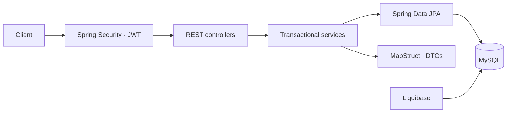

<div align="center">

# Online Book Store

**A Java REST API for a bookstore: catalog → cart → checkout → order history.**

[](https://github.com/ursusandwolf/online-book-store/actions/workflows/ci.yml)


[Quick start](#quick-start) · [API](#api-at-a-glance) · [Tests](#testing) · [Architecture](#architecture)

</div>

An educational backend built with Spring Boot, Spring Security, JPA and MySQL.
It covers the shopping flow and separates customer actions from catalog administration.
The application exposes JSON endpoints and OpenAPI documentation; it has no storefront UI.

## Features

- **Catalog:** paginated books and categories, category browsing, admin CRUD, soft deletion.
- **Accounts:** registration, BCrypt password hashing, JWT login and role checks.
- **Personal cart:** add books, combine quantities, update or remove items.
- **Checkout:** create an order and clear the cart atomically; store line totals at checkout.
- **Order history:** customer-owned orders and items, with admin status updates.
- **Schema and checks:** Liquibase, JPA schema validation, MySQL integration tests and Checkstyle.

## Quick start

Install Docker with Docker Compose. The container build includes Java 21 and Maven.

```bash
git clone https://github.com/ursusandwolf/online-book-store.git
cd online-book-store
cp .env.sample .env
```

On PowerShell, use `Copy-Item .env.sample .env`.
Fill in `MYSQLDB_PASSWORD`, `MYSQLDB_ROOT_PASSWORD` and `JWT_SECRET` in `.env`.
Use a randomly generated JWT secret of at least 32 UTF-8 bytes; for example, `openssl rand -hex 32`.
Database passwords and the signing secret have no application defaults. Keep `.env` private.

```bash
docker compose up --build -d
docker compose logs -f app
```

| Service | Default address |
| --- | --- |
| API | `http://localhost:8080` |
| Swagger UI | `http://localhost:8080/swagger-ui/index.html` |
| OpenAPI JSON | `http://localhost:8080/v3/api-docs` |
| MySQL from the host | `127.0.0.1:3307` |

MySQL starts first; the application applies migrations on startup. The named `mysql_data` volume
persists data across restarts. Stop services with `docker compose down`.
`docker compose down -v` also **deletes the database volume**.

### Run Java locally

Requires JDK 21, Maven 3.9+ and MySQL 8. No Maven wrapper is included.
Run only the database container with `docker compose up -d mysql`, or create a database
and user in your existing MySQL installation.

Export these variables into the shell running Maven:

```bash
export MYSQLDB_HOST=localhost
export MYSQLDB_PORT=3307
export MYSQLDB_DATABASE=online_book_store
export MYSQLDB_USER=bookstore_user
export MYSQLDB_PASSWORD='<the password from .env>'
export JWT_SECRET='<the secret from .env>'
mvn spring-boot:run
```

In PowerShell, use `$env:MYSQLDB_HOST='localhost'`, and the same syntax for the other variables.
Spring Boot does **not** automatically load `.env`; Docker Compose does.
For an existing MySQL installation, use its actual port.

To build an executable archive without running tests:

```bash
mvn -DskipTests package
java -jar target/online-book-store-0.0.1-SNAPSHOT.jar
```

### Configuration

| Variable | Purpose | Default / requirement |
| --- | --- | --- |
| `MYSQLDB_HOST` | MySQL host for local Java execution | `localhost`; Compose uses `mysql` |
| `MYSQLDB_PORT` | MySQL port for local Java execution | `3306`; Compose uses `3306` |
| `MYSQLDB_DATABASE` | Database name | `online_book_store` |
| `MYSQLDB_USER` | Database account | Set in `.env`; local Java defaults to `root` |
| `MYSQLDB_PASSWORD` | Database password | Required |
| `MYSQLDB_ROOT_PASSWORD` | Initialize the MySQL container | Required for Compose |
| `JWT_SECRET` | HMAC signing secret | Required; at least 32 UTF-8 bytes |
| `JWT_EXPIRATION` | Token lifetime in milliseconds | `300000` (5 minutes) |
| `MYSQLDB_LOCAL_PORT` | Host database port | `3307` in `.env.sample` |
| `SPRING_LOCAL_PORT` | Host application port | `8080` in `.env.sample` |

The app listens on port 8080 inside its container. Database port mappings bind to loopback.
The Compose setup is for local development; configure HTTPS and database TLS for deployment.

## Try the API

Register and log in:

```bash
curl -X POST http://localhost:8080/auth/registration \
  -H 'Content-Type: application/json' \
  -d '{"email":"reader@example.com","password":"password123","repeatPassword":"password123","firstName":"Alex","lastName":"Reader"}'

curl -X POST http://localhost:8080/auth/login \
  -H 'Content-Type: application/json' \
  -d '{"email":"reader@example.com","password":"password123"}'
```

Login returns `{"token":"..."}`. Send the token on protected requests:

```bash
curl 'http://localhost:8080/books?page=0&size=10&sort=title,asc' \
  -H 'Authorization: Bearer <token>'

curl -X POST http://localhost:8080/cart \
  -H 'Authorization: Bearer <token>' -H 'Content-Type: application/json' \
  -d '{"bookId":1,"quantity":2}'

curl -X POST http://localhost:8080/orders \
  -H 'Authorization: Bearer <token>' -H 'Content-Type: application/json' \
  -d '{"shippingAddress":"10 Book Street, Kyiv"}'
```

A fresh database has no catalog entries. Create a category and a book with an admin account
before adding a book to a cart. Replace example IDs with IDs returned by the API.

### Administrator setup

Registration creates a `USER` and a personal cart. There is no public role-management endpoint.
Register your own account, then grant `ADMIN` through a trusted database connection:

```sql
INSERT INTO users_roles (user_id, role_id)
SELECT u.id, r.id FROM users u CROSS JOIN roles r
WHERE u.email = 'your-admin@example.com' AND u.is_deleted = false AND r.name = 'ADMIN'
  AND NOT EXISTS (
    SELECT 1 FROM users_roles ur WHERE ur.user_id = u.id AND ur.role_id = r.id
  );
```

Keep `USER` if the administrator also needs cart and order endpoints.
The legacy seeded `admin@example.com` account is disabled by a migration when its original
password hash is unchanged. Accounts with a replaced hash are preserved.

## API at a glance

Paths are relative to the server root. Swagger UI and OpenAPI JSON are public.

| Method | Endpoint | Access | Purpose |
| --- | --- | --- | --- |
| POST | `/auth/registration` | Public | Register and create a cart |
| POST | `/auth/login` | Public | Get a JWT |
| GET | `/books`, `/books/{id}` | USER or ADMIN | Browse catalog |
| POST / PUT / DELETE | `/books` / `/books/{id}` | ADMIN | Manage books |
| GET | `/categories`, `/categories/{id}` | USER or ADMIN | Browse categories |
| GET | `/categories/{id}/books` | USER or ADMIN | Books in a category |
| POST / PUT / DELETE | `/categories` / `/categories/{id}` | ADMIN | Manage categories |
| GET / POST | `/cart` | USER | View cart / add a book |
| PUT / DELETE | `/cart/items/{cartItemId}` | USER | Set quantity / remove item |
| POST / GET | `/orders` | USER | Checkout / order history |
| GET | `/orders/{orderId}/items` | USER | Paginated order items |
| GET | `/orders/{orderId}/items/{itemId}` | USER | One owned order item |
| PATCH | `/orders/{orderId}` | ADMIN | Set order status |

Pages use zero-based `page`, `size` and `sort` parameters. Order-item lists are ordered by ID.
Order statuses are `PENDING`, `PROCESSING`, `COMPLETED` and `DELIVERED`;
administrators can currently set any supported value without a transition sequence.

Expected errors: `400` for invalid input or an empty cart, `401` for invalid credentials or tokens,
`403` for insufficient permissions, `404` for missing entities and inaccessible orders/items,
and `409` for duplicate or conflicting database records.

## Architecture



Controllers handle HTTP and access rules; services own business logic and transactions.
MapStruct converts entities to API DTOs. Cart writes and checkout lock the owning user row
until commit, serializing concurrent operations for that customer. Checkout stores each
line's total (`book price × quantity`) and clears the cart in the same transaction.

```text
src/main/java/com/lisu/onlinestore/
├── controller/   HTTP endpoints
├── service/      Business logic and transactions
├── dao/          JPA repositories
├── model/        Entities and enums
├── dto/          Request and response contracts
├── mapper/       MapStruct mappings
├── security/     JWT authentication
├── config/       Security configuration
├── exception/    HTTP error handling
└── validation/   Custom validation
src/main/resources/db/changelog/  Database migrations
src/test/                        Unit and MySQL integration tests
```

## Testing

With Docker running:

```bash
mvn --batch-mode verify
```

Testcontainers starts MySQL; no separately configured test database or `.env` is needed.
Tests apply Liquibase migrations and validate the resulting schema instead of recreating it with Hibernate.
Checkstyle uses the checked-in configuration. JaCoCo writes `target/site/jacoco/index.html`.

For a subset that runs without Docker:

```bash
mvn '-Dtest=*ServiceImplTest,AuthenticationControllerTest,*ValidatorTest,JwtSecurityTest' test
```

[GitHub Actions](https://github.com/ursusandwolf/online-book-store/actions/workflows/ci.yml)
runs full verification on `main` and pull requests, checks executable JAR packaging,
and uploads test reports. See [review notes](docs/CODE_REVIEW.md) for the maintenance fixes.

## Scope and contribution

Payments, inventory, refresh tokens and a storefront UI are outside the current scope.
Order-item pagination currently happens in memory; order history uses database pagination.
No standalone license file is included.

Use short-lived branches and open a pull request against `main`. Include the behavior changed
and verification performed. Keep migrations compatible with existing data, run `mvn verify`,
and delete the branch after merging.
